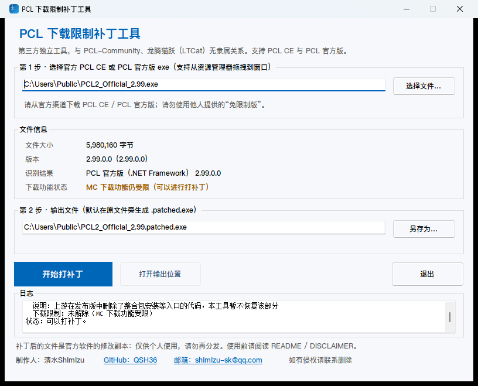
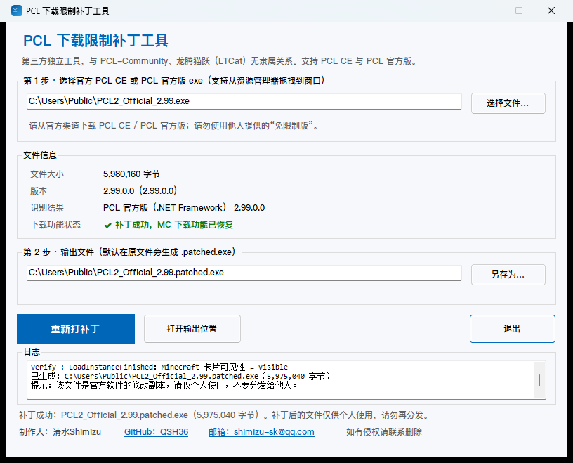
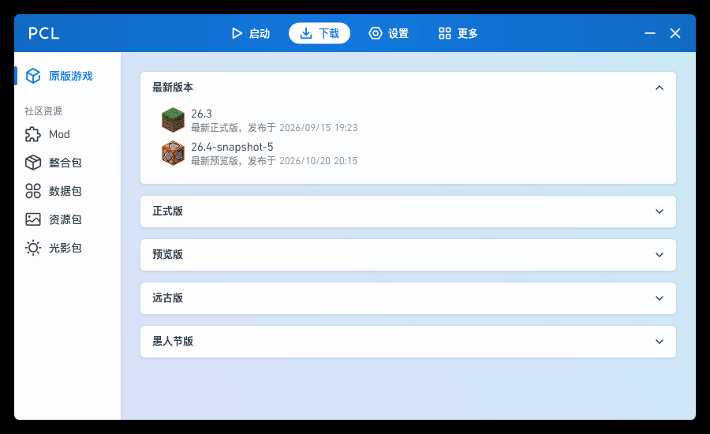

# PCL Download Restriction Patcher (PCL-CE-RegionPatch)

> Independent third-party tool. **Not affiliated with, authorized by, or endorsed by**
> PCL-Community or LTCat (龙腾猫跃). Please do not report issues caused by this tool to the
> upstream repositories.
>
> Author: **清水Shimizu** · GitHub [@QSH36](https://github.com/QSH36) · e-mail shimizu-sk@qq.com · contact for removal if anything infringes.

**This repository contains no PCL source code, binaries, or credentials, and offers no
pre-patched downloads.** It provides local tools (CLI + Windows GUI) that apply controlled
modifications to **user-owned** official executables, removing the "unavailable in mainland
China" gate.

Upstream credits:

- **Plain Craft Launcher 2 (PCL)** by **LTCat (龙腾猫跃)** — [repository](https://github.com/Meloong-Git/PCL) · [sponsor](https://afdian.com/a/LTCat)
- **PCL Community Edition (PCL CE)** maintained by **PCL-Community** — [repository](https://github.com/PCL-Community/PCL-CE)

## Supported builds

| Product | Tested version | Restored | Status |
| --- | --- | --- | --- |
| **PCL CE** (community edition, .NET single-file) | 2.15.1 x64 | MC download / install / repair / modpack / launch-time completion | ✅ full |
| **PCL official** (.NET Framework) | 2.99.0.0 | Download page **Minecraft version list** (vanilla + loaders install), Minecraft card in the modify page | ✅ restored |
| PCL official · modpack install entry | 2.99.0.0 | Online modpack installation | ⚠️ not restored (see below) |

The tool auto-detects the product and applies the matching patch.

## Background

- **PCL CE**: v2.15.1 (2026-10-20, PRs #3673 / #3676) disabled Minecraft downloads in mainland
  China. Upstream has an unmerged, reserved rollback PR #3677.
- **PCL official**: the 2.99.0.0 release (2026-10-20) states that PCL no longer provides the MC
  download feature. It is implemented with a compile-time constant
  `ModSecret.RestrictMcDownload = True`, and because of that the unrestricted branches were
  removed by the compiler from the release build. A binary patch therefore has to rebuild the
  affected entry points.

## GUI (recommended)



A Windows GUI (`src/PclCeRegionPatch.Gui`, WinForms / .NET 10) is included:

- pick or **drag & drop** an official exe — the product (PCL CE / PCL official), version and
  **restriction status** are shown automatically;
- one click generates `.patched.exe` (custom output path supported), with an "open output
  location" button;
- success state:



Download `pcl-ce-regionpatch-gui.exe` from Releases, or build it yourself:

```powershell
dotnet publish src/PclCeRegionPatch.Gui/PclCeRegionPatch.Gui.csproj -c Release -r win-x64 `
  --self-contained false -p:PublishSingleFile=true -p:IncludeNativeLibrariesForSelfExtract=true `
  -p:DebugType=None -p:DebugSymbols=false -o dist
```

The default publish is framework-dependent (about 0.8 MB) and requires the .NET 10 Desktop
Runtime (PCL CE itself requires it too). Use `--self-contained true` for a standalone executable.

## CLI

```powershell
dotnet build PclCeRegionPatch.slnx -c Release

pcl-ce-regionpatch PCL2_CE_Release_x64.exe            # PCL CE
pcl-ce-regionpatch "Plain Craft Launcher 2.exe"       # PCL official
pcl-ce-regionpatch --check <input.exe>                 # exit 0 = already patched
pcl-ce-regionpatch -o <output.exe> <input.exe>
```

Example output for PCL official:

```text
input     : ...\Plain Craft Launcher 2.exe (5,980,160 bytes)
target    : PCL official (.NET Framework) 2.99.0.0
output    : ...\Plain Craft Launcher 2.patched.exe (5,975,040 bytes)
step      : extracted 14 embedded dependency assemblies for metadata resolution (temp dir only)
step      : rebuilt PageDownloadInstall.LoaderInit to use the real DlClientListLoader
step      : restored PageDownloadModify Minecraft card visibility (1 place)
verify    : LoaderInit uses DlClientListLoader (real version list)
verify    : LoadInstanceFinished visibility = Visible
```

## How it works

### PCL CE (.NET single-file)

The tool locates the embedded main assembly (validated PE + IL-only requirement) and rewrites two
tiny IL method bodies of `PCL.RestrictedFeaturePolicy` (`Check` → `ldc.i4.1; ret`,
`get_IsRestricted` → `ldc.i4.0; ret`). The file size stays identical (6 bytes differ), official
embedded credentials are untouched.

### PCL official (.NET Framework)

1. detects `ModSecret.RestrictMcDownload` (compile-time true) to confirm a restricted build;
2. extracts 14 embedded dependency assemblies from the launcher's own `PCL.Resources` into a temp
   directory so Mono.Cecil can resolve metadata (deleted afterwards);
3. rebuilds `PageDownloadInstall.LoaderInit` to call the real `DlClientListLoader` and register the
   `LoadMinecraft_OnFinish` callback;
4. fixes the `PageDownloadModify.LoadInstanceFinished` Minecraft card visibility constant;
5. rewrites the assembly with Cecil and verifies the resulting IL. The output size may differ
   slightly, which is expected.

Modpack installation is not restored: the upstream compiler removed those code paths entirely
(e.g. the modpack dispatch logic no longer exists in the release build). Restoring it would mean
re-implementing the feature, which is out of scope for a patcher. Browsing Mods/Modpacks/resource
packs still works.

## Verified

- **PCL CE 2.15.1**: patched output matches the expected bytes; GUI and CLI produce identical
  SHA256.
- **PCL official 2.99.0.0**: patched build starts normally and the download page loads the online
  version list (26.3, 26.4-snapshot-5 and the release/preview categories):



- The GUI flow is covered by automation: load official exe → click patch → verify output.

## Limitations

- PCL official support is tested only against **2.99.0.0**. Future versions with a different
  structure cause a clear error instead of a broken file.
- PCL official modpack installation entry points are not restored.
- The official PCL patch rewrites the assembly; output size and the sigstore signature change.
- PCL CE support requires an IL-only main assembly inside a single-file build.
- The patched file is a modified copy of the upstream software: **do not redistribute it**.

## Safety

- Only obtain the original executable from the official release pages.
- Never download or share "pre-patched / unlocked" executables from third parties.
- Do not upload patched binaries or official executables to this repository's issues/PRs.

## Requirements

- Windows 10 1809+
- Official PCL CE **single-file** exe, or official PCL exe (.NET Framework 4.8)
- .NET 10 SDK to build; .NET 10 Runtime (CLI) / .NET 10 Desktop Runtime (GUI) to run

## Repository layout

```text
src/PclCeRegionPatch.Core/   # core library: PCL CE IL patch + PCL official patch
src/PclCeRegionPatch/        # command-line tool (cross-platform, net10.0)
src/PclCeRegionPatch.Gui/    # Windows GUI (WinForms, net10.0-windows, app icon included)
scripts/                     # utility scripts (make-icon.ps1)
docs/                        # screenshots and icon preview
```

## License & responsibility

The tool source code in this repository is licensed under the [MIT License](LICENSE). It contains
no PCL code or binaries. PCL and PCL CE are copyright their respective owners.

The upstream *PCL Distribution Limited License* only grants redistribution of **unmodified
copies**, so the patched output must **not** be redistributed. Using this tool to modify software
and then running the modified software is your own responsibility; you must comply with your local
laws and the upstream licenses.

## Author

- Author: **清水Shimizu**
- GitHub: [@QSH36](https://github.com/QSH36)
- E-mail: shimizu-sk@qq.com
- Contact the author for removal if anything infringes.

## Changelog

- **v1.2.1**: redesigned the application icon (download arrow + check); the status row is now
  product-specific: "region restriction status" for PCL CE and "download feature status" for
  PCL official (which removed the feature entirely rather than restricting a region).
- **v1.2.0**: added PCL official 2.99.0.0 support (rebuild download-page version loader, restore
  the modify-page Minecraft card); product auto-detection in GUI/CLI; new screenshots.
- **v1.1.0**: WinForms GUI, application icon, author credits.
- **v1.0.0**: PCL CE 2.15.1 patcher (CLI only).

## Disclaimer

Read [DISCLAIMER.md](DISCLAIMER.md) before use. This project is provided "AS IS", without warranty
of any kind.

## Related links

- PCL official 2.99.0.0 release: <https://github.com/Meloong-Git/PCL/releases/tag/2.99.0.0>
- PCL CE: <https://github.com/PCL-Community/PCL-CE>
- Upstream reserved rollback PR: <https://github.com/PCL-Community/PCL-CE/pull/3677>
- Restriction PRs: <https://github.com/PCL-Community/PCL-CE/pull/3673> · <https://github.com/PCL-Community/PCL-CE/pull/3676>
- Another author's similar tool (inspiration): <https://github.com/zhicheng233/PCL2-RegionPatch>
