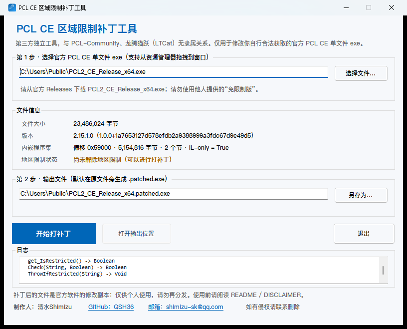
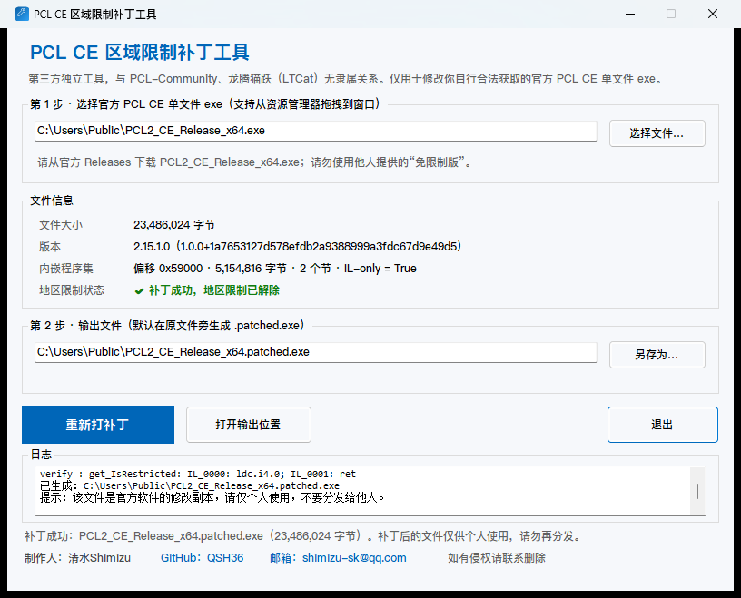

# PCL-CE-RegionPatch（PCL CE 区域限制移除补丁工具）

> **独立的第三方工具**，与 PCL-Community、龙腾猫跃（LTCat）无隶属、无授权、无背书关系。
> 请勿向官方仓库反馈由本工具产生的问题。
>
> 制作人：**清水Shimizu** · GitHub [@QSH36](https://github.com/QSH36) · 邮箱 shimizu-sk@qq.com · 如有侵权请联系删除

**本仓库不包含任何 PCL 的源代码、二进制或密钥，也不提供任何成品下载。** 它只提供本地工具
（命令行版与 Windows 图形界面版）：在**你自己的电脑上**，对**你自己合法获取**的官方 PCL CE
单文件 exe 做受控修改，移除「中国大陆地区不可用」的判断。

上游致谢：

- **Plain Craft Launcher 2 (PCL)** · 作者 **龙腾猫跃 (LTCat)** · [仓库](https://github.com/Meloong-Git/PCL) · [赞助链接](https://afdian.com/a/LTCat)
- **PCL Community Edition (PCL CE)** · 维护 **PCL-Community** · [仓库](https://github.com/PCL-Community/PCL-CE)

---

## 背景

2026-10-20 发布的 PCL CE v2.15.1 通过 #3673 / #3676 在中国大陆地区禁用了 Minecraft 的下载、
安装、补全与整合包安装。上游仓库中目前存在一个**尚未合并**的预留回滚 PR #3677
（`fix(install): 移除中国大陆地区下载安装限制`）。

本项目是一个独立的外部工具，效果与上述回滚等价，但作用于**二进制**：不需要完整的 .NET 构建
环境，也不接触任何官方密钥。

## 图形界面版（GUI，推荐给不想用命令行的用户）



`src/PclCeRegionPatch.Gui` 提供 Windows 图形界面（WinForms / .NET 10）：

- 选择或**拖拽**官方 `PCL2_CE_Release_x64.exe` → 自动显示文件大小、版本、内嵌程序集、
  **地区限制状态**（已解除 / 尚未解除）；
- 一键生成 `.patched.exe`，可自定义输出路径、打补丁后直接打开输出位置；
- 打补丁后的状态：



从 Release 下载 `pcl-ce-regionpatch-gui.exe`，或自行构建：

```powershell
dotnet publish src/PclCeRegionPatch.Gui/PclCeRegionPatch.Gui.csproj -c Release -r win-x64 `
  --self-contained false -p:PublishSingleFile=true -p:IncludeNativeLibrariesForSelfExtract=true `
  -p:DebugType=None -p:DebugSymbols=false -o dist
```

> 默认是**框架依赖**单文件（约 0.7 MB），需要 .NET 10 Desktop Runtime（PCL CE 本身也依赖它，
> 通常已安装）。如果要在未安装 .NET 10 的电脑上使用，把 `--self-contained false` 换成
> `--self-contained true`（体积会大很多）。

## 它做了什么

把 `PCL.RestrictedFeaturePolicy` 的两个方法体各改写 3 个字节：

| 方法 | 原行为 | 修改后 |
| --- | --- | --- |
| `Check(string, bool)` | 按地区判断是否拦截功能 | `ldc.i4.1; ret`（永远返回 `true`） |
| `get_IsRestricted()` | 按地区判断是否受限 | `ldc.i4.0; ret`（永远返回 `false`） |

因此：不可用状态解除，下载/安装/补全/整合包恢复。

- **不读取、不导出、不修改任何官方密钥**（`MS_CLIENT_ID`、`CURSEFORGE_API_KEY` 等原样保留）；
- 输出文件与官方原版**大小完全相同**（实测仅 6 字节差异），不重写 PE、不重新打包。

## 它不是什么

- ❌ 不是 PCL CE 的 fork / 修改发行版；本仓库没有 PCL 代码或二进制。
- ❌ 不提供「下载即用」的修改版 exe，请自行用本工具处理自己的官方副本。
- ❌ 不提供任何形式的担保，也不保证符合你所在地的法律法规。

## 使用范围与合规提示

本工具由第三方独立开发，不针对任何特定国家或地区进行推广，也不提供成品下载、不收集任何
用户信息。

上游是出于其所在地法律法规的考虑才加入地区限制，本项目只移除这一技术限制。使用前请自行确认：

- 你拥有所修改软件的合法副本；
- 你的行为（修改软件、运行修改后的软件）不违反你所在地的法律法规；
- 你理解修改后的软件由你自行使用，本项目不提供任何担保。

如果你对这些条件有疑虑，请不要使用本工具。

## 环境要求

- Windows 10 1809 或更高（官方 PCL CE 的运行要求）
- 官方 PCL CE **单文件** exe（v2.15.1 x64 已测试）
- .NET 10 SDK（构建工具时需要）
- .NET 10 Runtime（运行命令行版）/ .NET 10 Desktop Runtime（运行 GUI 版）

## 构建

```powershell
# 一次构建全部项目（核心库 / 命令行 / GUI）
dotnet build PclCeRegionPatch.slnx -c Release

# 单独构建命令行版
dotnet build src/PclCeRegionPatch/PclCeRegionPatch.csproj -c Release
```

产物：

- 命令行：`src/PclCeRegionPatch/bin/Release/net10.0/pcl-ce-regionpatch.dll`
- GUI：`src/PclCeRegionPatch.Gui/bin/Release/net10.0-windows/pcl-ce-regionpatch-gui.exe`
  （单文件发布方式见上文）

## 仓库结构

```text
src/PclCeRegionPatch.Core/   # 核心库：定位内嵌程序集、解析 PE、打 IL 补丁
src/PclCeRegionPatch/        # 命令行版（跨平台，net10.0）
src/PclCeRegionPatch.Gui/    # Windows 图形界面版（WinForms，net10.0-windows，含 app.ico）
scripts/                     # 杂项脚本（make-icon.ps1：生成多尺寸应用图标）
docs/                        # 截图与图标预览
```

## 用法

### GUI 版

直接双击 `pcl-ce-regionpatch-gui.exe`（或从 Release 下载）：

1. 选择 / 拖入官方 `PCL2_CE_Release_x64.exe`；
2. 确认信息与默认输出路径（默认在原文件旁生成 `.patched.exe`）；
3. 点击「开始打补丁」，成功后点「打开输出位置」即可。

### 命令行版

```powershell
# 默认输出 <输入文件名>.patched.exe，且与输入放在同一目录
pcl-ce-regionpatch PCL2_CE_Release_x64.exe

# 指定输出路径
pcl-ce-regionpatch -o PCL2_CE_Release_x64_patched.exe PCL2_CE_Release_x64.exe

# 只检查某个文件是否已经打过补丁（退出码 0 = 已打补丁）
pcl-ce-regionpatch --check PCL2_CE_Release_x64_patched.exe
```

实际输出示例（对官方 v2.15.1 x64）：

```text
input     : ...\PCL2_CE_Release_x64.exe (23,486,024 bytes)
assembly  : file offset 0x59000, image 0x4EA800, sections 2, IL-only True, managed-native-header False
output    : ...\PCL2_CE_Release_x64.patched.exe (23,486,024 bytes)
patched   : Check -> ldc.i4.1; ret  (file offset 0xA72B4, old header 0x13)
patched   : get_IsRestricted -> ldc.i4.0; ret  (file offset 0xA72A5, old header 0x2E)
verify    : Check: IL_0000: ldc.i4.1 ; IL_0001: ret
verify    : get_IsRestricted: IL_0000: ldc.i4.0 ; IL_0001: ret
```

> 运行后把生成的文件改个名字直接用即可。数据目录、配置与官方版共用（便携模式会建在 exe 同目录
> 的 `PCL` 文件夹）。

## 原理

PCL CE 使用 .NET **单文件发布**：exe = apphost PE + 追加的 bundle，主程序集
`Plain Craft Launcher 2.dll` 内嵌在 bundle 中且默认不压缩。工具的处理流程：

1. 用只存在于主程序集中的元数据字符串（`RestrictedFeaturePolicy`）定位内嵌程序集起点，
   并校验它是一个合法的、处于 `IL-only` 状态的 .NET PE（ReadyToRun / 非 .NET 的候选会被拒绝）；
2. 解析 PE 节表，把方法 RVA 换算为文件偏移；
3. 用 [Mono.Cecil](https://github.com/jbevain/cecil) 读取程序集，定位 `Check` 与 `get_IsRestricted`；
4. 原地写入 tiny method body：`0x0A, 0x17, 0x2A` 与 `0x0A, 0x16, 0x2A`；
5. 重新读取校验 IL 并打印结果。

由于只是原地覆盖方法体，文件大小、PE 布局、bundle 内容都不变。

## 已验证 / 已知限制

已验证：官方 PCL Community Edition v2.15.1 x64（`PCL2_CE_Release_x64.exe`，23,486,024 字节）。

- 命令行版与 GUI 版共用同一套核心逻辑（`PclCeRegionPatch.Core`），打补丁后文件逐字节一致；
- GUI 版已实际测试：选择官方 exe → 点击打补丁 → 输出文件与命令行结果 SHA256 完全相同；
- 修改后文件与官方原版大小相同，仅 6 字节差异，官方内嵌密钥保持原样。

限制：

- 只适用于**内嵌主程序集为 IL-only** 的官方单文件构建；如果官方未来改用 ReadyToRun、压缩
  bundle 或改变类型/方法名，工具会明确报错，而不是产出坏文件。
- 修改会破坏官方 sigstore 签名（这是预期行为，不影响运行）。
- 修改后的文件属于上游软件的修改副本，**请勿再分发**（见下方与 [DISCLAIMER.md](DISCLAIMER.md)）。

## 安全提示

- 只从官方 Release 页面（<https://github.com/PCL-Community/PCL-CE/releases>）获取原始 exe；
- 不要使用、也不要传播任何第三方提供的「免限制版 / 破解版」exe，它们无法验证是否被植入内容；
- 不要把你处理后的文件或官方 exe 提交到本仓库的 Issue / PR 中。

## 许可与责任

- 本仓库的**工具源代码**使用 [MIT License](LICENSE)。
- 本仓库**不包含** PCL / PCL CE 的任何代码或二进制；仅在互操作意义上引用公开可见的命名空间与
  类型名。PCL 与 PCL CE 的版权归其各自权利人所有。
- 上游《PCL 分发有限许可》只授权分发「原样副本」，因此**修改后的二进制不在授权范围内**，
  请不要分发本工具的输出文件。
- 本工具与上游无隶属关系；使用本工具修改软件、以及之后如何使用修改后的软件，均由你自行负责，
  并应遵守当地法律法规与上游许可。

## 制作人

- 制作人：**清水Shimizu**
- GitHub：[@QSH36](https://github.com/QSH36)
- 联系邮箱：shimizu-sk@qq.com
- 如有侵权请联系删除（同上邮箱）。

## 免责声明

使用前请阅读 [DISCLAIMER.md](DISCLAIMER.md)。本项目按「现状」提供，不附带任何担保。

## 相关链接

- 上游 PR #3677（预留回滚）：<https://github.com/PCL-Community/PCL-CE/pull/3677>
- 限制引入的 PR：#3673 <https://github.com/PCL-Community/PCL-CE/pull/3673>、#3676 <https://github.com/PCL-Community/PCL-CE/pull/3676>
- 另一位作者的同类工具（思路参考）：<https://github.com/zhicheng233/PCL2-RegionPatch>

---

## English summary

An independent, third-party CLI tool that removes the mainland-China region gate from a
**user-owned** official PCL CE single-file build. It rewrites two tiny IL method bodies
(`Check` → `ldc.i4.1; ret`, `get_IsRestricted` → `ldc.i4.0; ret`), changing 6 bytes in total and
leaving credentials and file size untouched. This repository contains **no** PCL code, binaries or
credentials, and provides **no** pre-patched downloads. Not affiliated with PCL or PCL CE. Use only
on copies you obtained legally; do not redistribute patched binaries; you are responsible for
complying with local laws and upstream licenses.
